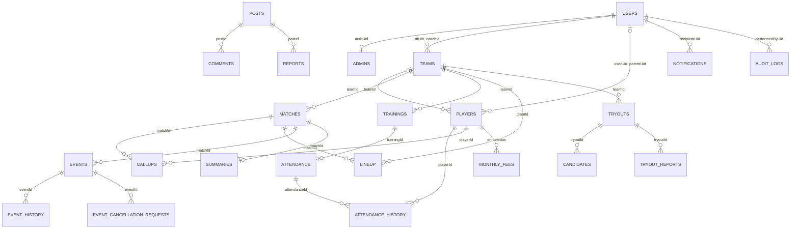

# Relaciones

La selección de rival sigue usando el nombre existente cuando el rival es externo. El plantel se consulta por `players.teamId`. Las listas de convocados y titulares siguen el formato del partido. Las cuotas son elementos de `players.monthlyFees`; el estado pagado pertenece al elemento vigente.

La asistencia usa un único documento grupal por sesión. La transacción valida jugadores del equipo, comprueba IDs repetidos y actualiza la proyección por jugador. Cancela el entrenamiento o partido para conservar el historial. Usa la desactivación del jugador y las transiciones del equipo que ofrece la app. La eliminación de pruebas y anuncios conserva la política previa y necesita una decisión adicional para archivar sus dependencias.

Los listeners de partidos, planteles, entrenamientos, comunidad y otros módulos continúan leyendo las colecciones vigentes. El catálogo mantiene el listener y respaldo local existentes.
